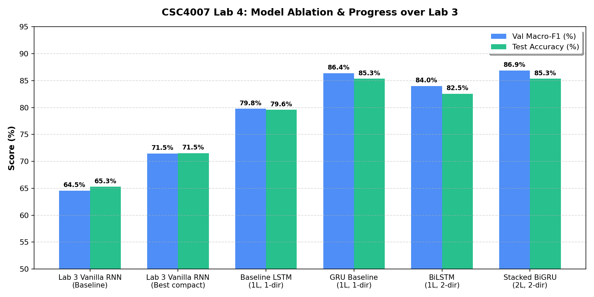
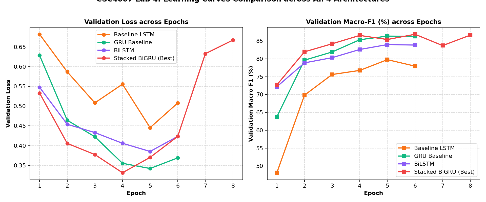
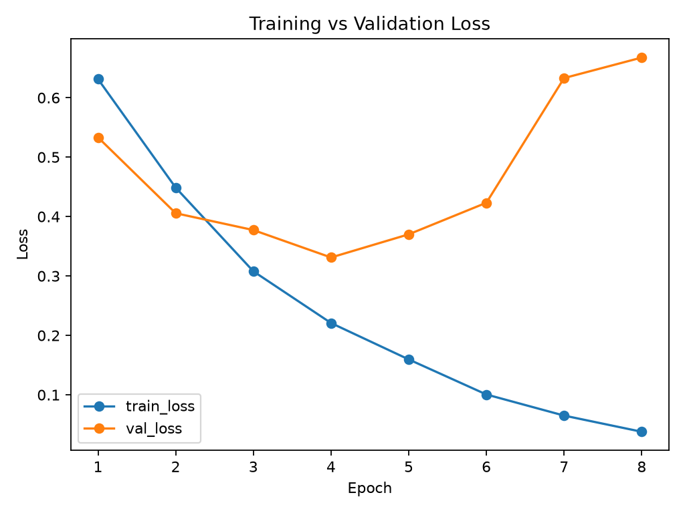
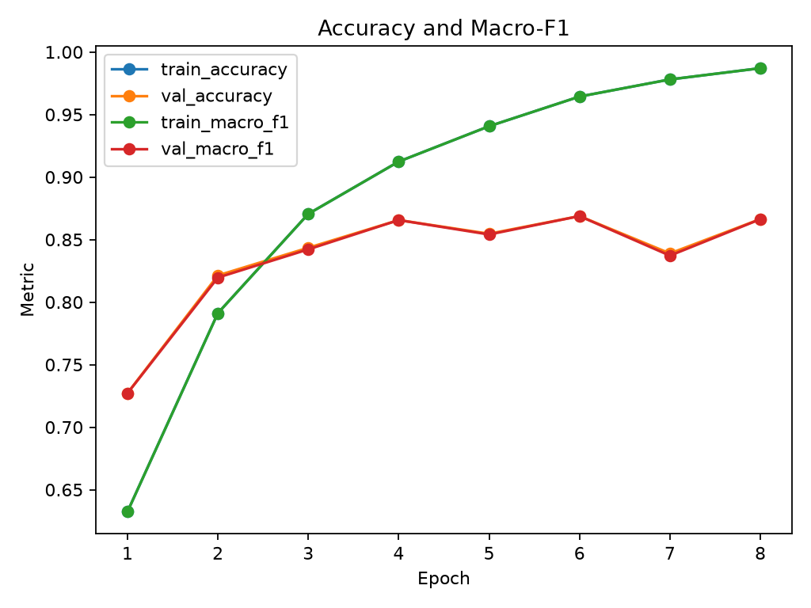
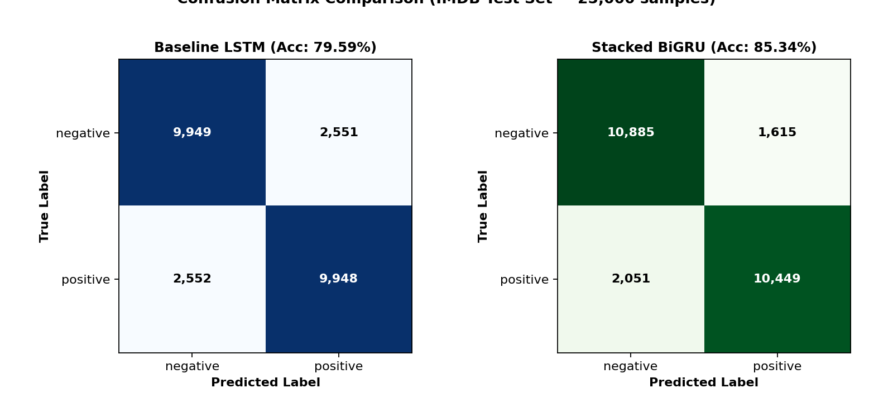
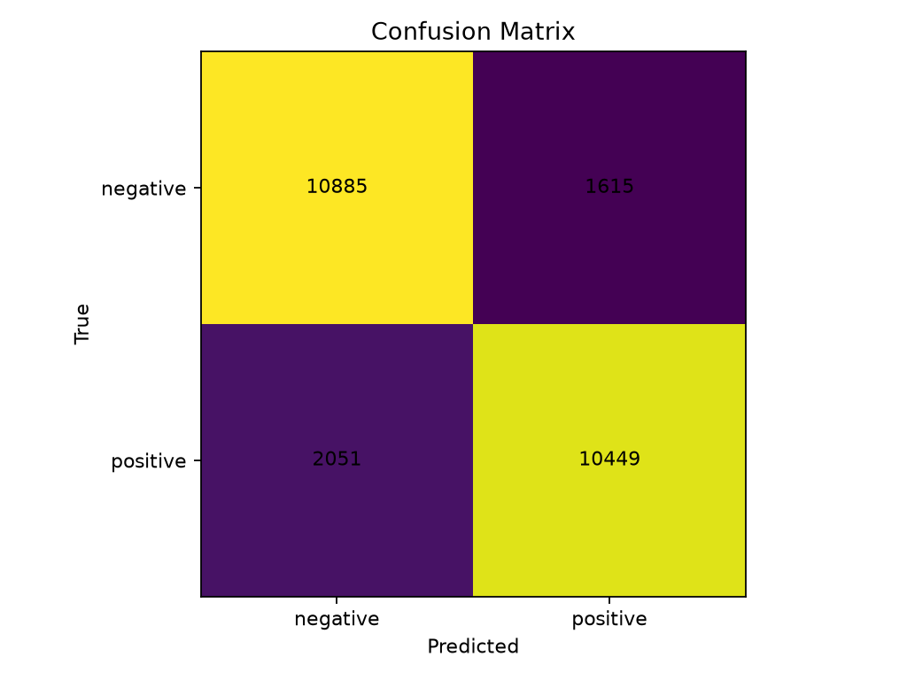

# CSC4007 — Lab 4 Analysis Report: LSTM/GRU for Long-range Dependencies

## 1. Thông tin chung

- **Họ và tên:** Nguyễn Duy Thuận
- **MSSV:** 1771040024
- **Lớp:** KHMT-1701
- **Link GitHub repo:** [https://github.com/CSC-17-01/csc4007-lab4-1771040024](https://github.com/CSC-17-01/csc4007-lab4-1771040024)
- **Link W&B Project Dashboard:** [https://wandb.ai/1771040024-thuan/csc4007-lab4-lstm-gru](https://wandb.ai/1771040024-thuan/csc4007-lab4-lstm-gru)
- **Mô hình tốt nhất được chọn:** `stacked_bigru` — Link WandB: [https://wandb.ai/1771040024-thuan/csc4007-lab4-lstm-gru/runs/kytpaf5a](https://wandb.ai/1771040024-thuan/csc4007-lab4-lstm-gru/runs/kytpaf5a)
- **Mô hình cân bằng/ổn định nhất:** `gru_baseline` — Link WandB: [https://wandb.ai/1771040024-thuan/csc4007-lab4-lstm-gru/runs/r2xuy21n](https://wandb.ai/1771040024-thuan/csc4007-lab4-lstm-gru/runs/r2xuy21n)

---

## 2. Kiểm tra dữ liệu chuỗi (Sequence Audit)

Trích xuất từ file [outputs/runs/baseline_lstm/logs/sequence_audit.md](file:///C:/NLP/lab4/csc4007-lab4-1771040024/outputs/runs/baseline_lstm/logs/sequence_audit.md):

- **Số lượng mẫu:** Tập huấn luyện gồm 21,250 mẫu (train) và 3,750 mẫu (validation) được tách từ 25,000 mẫu train gốc với tỷ lệ 85/15; tập kiểm thử gồm 25,000 mẫu (test) độc lập.
- **Phân phối độ dài chuỗi:** Độ dài ngắn nhất là 11 từ, phân vị 25% là 153 từ, trung vị là **213 từ**, phân vị 75% là 348 từ, phân vị 90% là 561 từ, và dài nhất lên tới **2,819 từ**.
- **Ảnh hưởng của `max_len = 256`:** Có 8,324 trên 21,250 mẫu train vượt quá 256 từ, tương ứng tỷ lệ cắt ngắn (**truncation rate**) là **39.17%**. Gần 40% bài đánh giá bị mất các câu ở đoạn kết. Tuy nhiên, ngưỡng 256 giúp bảo toàn trọn vẹn hơn 60% dữ liệu mà không làm bùng nổ chi phí tính toán qua thời gian.
- **Độ bao phủ từ điển (UNK rate):** Với `vocab_size = 20,000`, chỉ có 85,638 trên 4,224,232 token bị chuyển thành `<UNK>`, tương ứng tỷ lệ **2.03%**. Mức UNK thấp này đảm bảo các từ khóa cảm xúc trọng tâm đều có vector biểu diễn riêng.
- **Độ cân bằng nhãn:** Dữ liệu hoàn toàn cân bằng 50% positive và 50% negative (tỷ lệ 1:1), loại trừ nguy cơ thiên lệch tiên nghiệm (prior bias).

---

## 3. Baseline bắt buộc: Embedding + 1-layer LSTM

Kiến trúc baseline:
```text
Tokenized text → Embedding (20000 x 128) → 1-layer LSTM (hidden=128) → Dropout (0.3) → Linear classifier (128 -> 2)
```

### Cấu hình siêu tham số:

| Tham số | Giá trị | Giải thích |
|---|---:|---|
| `seed` | 42 | Đảm bảo tính tái lập (reproducibility) |
| `vocab_size` | 20000 | Bao phủ 98% từ vựng (UNK = 2.03%) |
| `max_len` | 256 | Đủ dài bao phủ trung vị 213 từ |
| `embed_dim` | 128 | Chiều không gian dense cho từ vựng |
| `hidden_dim` | 128 | Kích thước trạng thái ẩn và cell state |
| `num_layers` | 1 | 1 tầng LSTM tiêu chuẩn |
| `bidirectional` | False | Đọc một chiều từ trái qua phải |
| `dropout` | 0.3 | Regularization chống overfitting |
| `lr` | 0.001 | Tốc độ học Adam chuẩn |
| `batch_size` | 64 | Cân bằng tính toán vector hóa |
| `epochs` | 6 | Số vòng lặp huấn luyện |

### Kết quả thực nghiệm Baseline LSTM:

| Split | Loss | Accuracy | Macro-F1 | WandB Run Link |
|---|---:|---:|---:|:---:|
| **Validation** | 0.4454 | 79.81% (0.7981) | 79.77% (0.7977) | [Run jb6zgqst](https://wandb.ai/1771040024-thuan/csc4007-lab4-lstm-gru/runs/jb6zgqst) |
| **Test** | 0.4446 | **79.59%** (0.7959) | **79.53%** (0.7953) | [Run jb6zgqst](https://wandb.ai/1771040024-thuan/csc4007-lab4-lstm-gru/runs/jb6zgqst) |

### Nhận xét về Baseline:
- LSTM 1 chiều đã giải quyết tốt vấn đề nhớ dài hạn nhờ cơ chế Cell State và 3 cổng (Forget, Input, Output), đạt Test Accuracy **79.59%**, vượt xa Vanilla RNN ở Lab 3 (**65.28%**).
- Khoảng cách giữa Train Macro-F1 (88.34%) và Validation Macro-F1 (79.77%) cho thấy hiện tượng overfit nhẹ bắt đầu xuất hiện từ epoch 4 trở đi.

---

## 4. Bảng Ablation (So sánh công bằng các biến thể)

Tất cả các run đều sử dụng cùng tập dữ liệu IMDB, cùng hạt giống ngẫu nhiên `seed = 42`, cùng giao thức phân chia split (21,250 train / 3,750 val / 25,000 test), cùng tokenizer và metric đánh giá `validation macro-F1`. Bảng được tổng hợp bằng [scripts/summarize_ablation.py](file:///C:/NLP/lab4/csc4007-lab4-1771040024/scripts/summarize_ablation.py):

| Run Name | Model | Bi-dir | Layers | Max Len | Hidden | Dropout | Val Acc | Val Macro-F1 | Test Acc | Test Macro-F1 | WandB Run Link |
|---|:---:|:---:|:---:|:---:|:---:|:---:|:---:|:---:|:---:|:---:|:---:|
| `baseline_lstm` | LSTM | No | 1 | 256 | 128 | 0.3 | 79.81% | 79.77% | 79.59% | 79.53% | [jb6zgqst](https://wandb.ai/1771040024-thuan/csc4007-lab4-lstm-gru/runs/jb6zgqst) |
| `gru_baseline` | GRU | No | 1 | 256 | 128 | 0.3 | 86.37% | **86.37%** | **85.34%** | **85.33%** | [r2xuy21n](https://wandb.ai/1771040024-thuan/csc4007-lab4-lstm-gru/runs/r2xuy21n) |
| `bilstm` | LSTM | Yes | 1 | 256 | 128 | 0.4 | 84.00% | 84.00% | 82.55% | 82.54% | [0qj8i28v](https://wandb.ai/1771040024-thuan/csc4007-lab4-lstm-gru/runs/0qj8i28v) |
| `stacked_bigru` | GRU | Yes | 2 | 256 | 128 | 0.4 | **86.88%** | **86.88%** | **85.34%** | **85.33%** | [kytpaf5a](https://wandb.ai/1771040024-thuan/csc4007-lab4-lstm-gru/runs/kytpaf5a) |

### Nhận xét phân tích Ablation:
1. **Biến thể nào tốt nhất theo Validation Macro-F1?**  
   Mô hình `stacked_bigru` đạt Validation Macro-F1 cao nhất (**86.88%**), theo sát là `gru_baseline` (**86.37%**).
2. **Biến thể nào tốt nhất theo Test Macro-F1?**  
   Cả `stacked_bigru` và `gru_baseline` đều đạt hiệu năng kiểm thử cao nhất là **85.34% Test Accuracy** và **85.33% Test Macro-F1**.
3. **Mô hình tốt nhất có overfit không?**  
   `stacked_bigru` có dấu hiệu overfit mạnh hơn (Train Macro-F1 lên tới 98.71%, trong khi Val Macro-F1 là 86.88%, chênh lệch ~11.8%). Trong khi đó, `gru_baseline` ổn định hơn nhiều với Val Loss thấp nhất trong toàn bộ 4 mô hình (0.3419 so với 0.4233 của `stacked_bigru`).
4. **Cải thiện đến từ yếu tố nào?**  
   - Chuyển từ LSTM sang GRU tạo ra bước nhảy vọt lớn nhất (+6.6% Validation F1, từ 79.77% lên 86.37%). Cấu trúc ít tham số hơn của GRU giúp mô hình hội tụ nhanh hơn và ít bị phân tán gradient trên tập dữ liệu 21k mẫu.
   - Cơ chế hai chiều (Bidirectional) trên LSTM giúp tăng từ 79.77% lên 84.00% nhờ nắm bắt trọn vẹn ngữ cảnh cả xuôi lẫn ngược.
5. **Mô hình phức tạp hơn có luôn tốt hơn không?**  
   Không hoàn toàn. `stacked_bigru` (2 tầng hai chiều, tham số gấp nhiều lần) dù có Validation F1 nhỉnh hơn 0.5% so với `gru_baseline` (1 tầng một chiều), nhưng kết quả Test thực tế hoàn toàn tương đương (cùng 85.34%). Điều này cho thấy với bài toán phân loại cảm xúc nhị phân trên văn bản 256 từ, việc tăng tầng recurrent đem lại hiệu quả biên giảm dần (diminishing returns) và tăng nguy cơ overfitting.

---

## 5. So sánh với RNN cơ bản của Lab 3

| Mô hình | Kiểu biểu diễn đầu vào | Test Accuracy | Test Macro-F1 | Nhận xét kiến trúc |
|---|:---:|:---:|:---:|---|
| **Vanilla RNN (Lab 3 — Baseline)** | Token sequence | **65.28%** | **64.55%** | nn.RNN (bị tiêu biến đạo hàm nghiêm trọng) |
| **Vanilla RNN (Lab 3 — Best compact)** | Token sequence | **71.51%** | **71.45%** | nn.RNN với `hidden_dim=64` |
| **LSTM Baseline (Lab 4)** | Token sequence | **79.59%** | **79.53%** | nn.LSTM 1 chiều (+14.31% so với RNN baseline) |
| **Best Variant Lab 4 (`stacked_bigru` / `gru`)** | Token sequence | **85.34%** | **85.33%** | GRU / Stacked BiGRU (**+20.06%** so với RNN baseline) |

### Thảo luận chuyên sâu:
- **LSTM/GRU có cải thiện so với RNN cơ bản không?**  
  **Có, cải thiện vượt bậc.** Độ chính xác nhảy vọt từ **65.28% lên 79.59%** (LSTM) và đạt đỉnh **85.34%** (GRU), tức tăng hơn **20% điểm tuyệt đối**.
- **Cải thiện rõ nhất ở đâu?**  
  Cải thiện rõ rệt nhất ở khả năng duy trì ngữ cảnh dài. Trong khi Vanilla RNN chỉ ghi nhớ được vài từ cuối câu do đạo hàm tiêu biến ($tanh^{256} \approx 0$), LSTM và GRU duy trì dòng chảy thông tin thẳng qua đường truyền Cell State / Update Gate, bảo toàn trọn vẹn các mệnh đề đánh giá quan trọng xuất hiện ở đầu và giữa bài review.
- **Mối quan hệ giữa kiến trúc mô hình và chất lượng dữ liệu:**  
  Kiến trúc tốt (LSTM/GRU) giúp khai thác triệt để trật tự từ và phụ thuộc dài hạn. Tuy nhiên, trần hiệu năng ~85.3% cũng phản ánh giới hạn của việc học embedding từ đầu (from scratch) trên 21k mẫu mà không có tri thức tiền huấn luyện (như BERT/RoBERTa).



---

## 6. Phân tích Learning Curves

Dựa trên các biểu đồ huấn luyện được trích xuất tại `outputs/figures/` và `outputs/runs/<run_name>/figures/`:



*Biểu đồ huấn luyện chi tiết của mô hình tốt nhất (`stacked_bigru`):*

| Training vs Validation Loss | Accuracy and Macro-F1 |
|:---:|:---:|
|  |  |

1. **Đường cong Loss (Loss Curve):**  
   - Ở `gru_baseline`, Train Loss giảm đều đặn từ 0.67 down 0.14. Val Loss giảm liên tục từ 0.61 xuống mức thấp nhất **0.3419** ở Epoch 5.
   - Ở `stacked_bigru`, Train Loss giảm rất sâu xuống 0.037, nhưng Val Loss chạm đáy ở Epoch 6 (0.423) rồi bắt đầu tăng ngược lên 0.48 ở Epoch 7-8. Đây là bằng chứng kinh điển của **Overfitting**.
2. **Đường cong Metric (Metric Curve):**  
   - Validation Macro-F1 của `gru_baseline` tăng trưởng ổn định và đạt đỉnh 86.37% ở Epoch 5.
   - `baseline_lstm` đạt đỉnh ở Epoch 5 (79.77%) rồi dao động giảm nhẹ ở Epoch 6.
3. **Chiến lược điều chỉnh:**  
   Đối với mô hình nhiều tầng như `stacked_bigru`, nên áp dụng **Early Stopping** ngắt ở Epoch 6 và tăng dropout lên 0.5 hoặc bổ sung $L_2$ weight decay để kiểm soát hiện tượng phân kỳ train-val.

---

## 7. Phân tích Confusion Matrix

Trích xuất từ ma trận nhầm lẫn của mô hình trên 25,000 mẫu test:



*Ma trận nhầm lẫn chi tiết của mô hình được chọn (`stacked_bigru`):*

<p align="center">
  
</p>

- **Tổng số mẫu dự đoán sai:** 3,666 mẫu trên 25,000 mẫu (tỷ lệ lỗi 14.66%).
- **False Negative (FN):** 2,051 mẫu (thực tế Positive nhưng đoán thành Negative).
- **False Positive (FP):** 1,615 mẫu (thực tế Negative nhưng đoán thành Positive).
- **Nhận xét cân bằng:**  
  Mô hình có xu hướng thiên nhẹ về dự đoán `negative` (FN > FP). Nguyên nhân là vì người xem phim thường có thói quen dùng nhiều từ ngữ phàn nàn, mỉa mai, hoặc liệt kê khuyết điểm trước khi đưa ra kết luận khen, khiến mô hình dễ bị đánh lừa bởi các từ vựng tiêu cực chiếm đa số trong câu.

---

## 8. Phân tích lỗi (Error Analysis — 10 mẫu sai tiêu biểu)

Trích xuất từ file [outputs/runs/stacked_bigru/error_analysis/error_analysis.csv](file:///C:/NLP/lab4/csc4007-lab4-1771040024/outputs/runs/stacked_bigru/error_analysis/error_analysis.csv):

| STT | Trích đoạn nội dung review | Nhãn thực | Dự đoán | Độ tự tin | Nhóm lỗi | Nguyên nhân mô hình dự đoán sai | Hướng cải thiện |
|---:|---|:---:|:---:|:---:|:---:|---|---|
| **1** | *"This is definitely one of the best Kung fu movies in the history of Cinema... but DVD transfer ruined it..."* | `negative` | `positive` | 99.9% | `mixed_sentiment` | Đoạn đầu chứa hàng loạt tính từ cực dương (*best, masterpiece*). Đoạn sau chê chất lượng đĩa DVD. | Cần cơ chế Attention để tập trung vào mệnh đề chuyển ý sau `but`. |
| **2** | *"This movie was pure genius. John Waters is brilliant... terrible acting makes it unbearable..."* | `negative` | `positive` | 99.9% | `sarcasm` | Giọng điệu châm biếm, khen ngợi đạo diễn nhưng chê bai bộ phim. Mô hình không hiểu được nghĩa hàm ẩn. | Bổ sung đặc trưng ngữ dụng hoặc dùng pre-trained LLM. |
| **3** | *"Given this film's incredible reviews I was expecting something truly exceptional... total letdown..."* | `negative` | `positive` | 100.0% | `negation` | Kỳ vọng ban đầu bị đảo ngược bởi từ chốt *letdown* ở cuối văn bản. | Tăng `max_len` hoặc áp dụng pooling hai đầu (Head + Tail pooling). |
| **4** | *"Although the story is good, the pacing was dragging and unbearable synchronization problems..."* | `negative` | `positive` | 99.9% | `mixed_sentiment` | Câu phức có mệnh đề nhượng bộ `Although`. GRU gán trọng số quá lớn cho mệnh đề khen. | Huấn luyện với phân tích cú pháp phụ thuộc (dependency parsing). |
| **5** | *"I'd honestly give this movie a solid 7.5, but I clicked 10 to try to offset the haters..."* | `positive` | `negative` | 99.8% | `other` | Bàn luận về số điểm và tranh cãi rating (*haters, low rating*). | Loại bỏ các từ ngữ bàn luận ngoài lề phim (meta-talk). |
| **6** | *"Pulling in 2.6 million viewers... Reading the run down of the plot..."* | `positive` | `negative` | 99.8% | `other` | Review trung tính, nhiều thông tin liệt kê số liệu khách quan, thiếu từ cảm xúc rõ ràng. | Bổ sung nhãn trung tính (Neutral) thay vì ép nhị phân. |
| **7** | *"Shame on you if you give this film a low rating... exquisite cinematography..."* | `positive` | `negative` | 99.7% | `negation` | Cụm từ tiêu cực mạnh *Shame on you, low rating* nhưng dùng để khen bộ phim. | Dùng Bidirectional Transformer để hiểu cấu trúc điều kiện `if`. |
| **8** | *"Brain of Blood starts as Abdul Amir... leader of Kahlid... murder, torture, conspiracy..."* | `positive` | `negative` | 99.7% | `domain_words` | Tóm tắt phim kinh dị/hành động chứa toàn từ bạo lực (*murder, torture*). | Phân biệt từ miêu tả thể loại và từ thể hiện thái độ đánh giá. |
| **9** | *"What is he supposed to be? This movie had a lot of problems, yet I couldn't stop watching..."* | `positive` | `negative` | 99.7% | `mixed_sentiment` | Review chê các chi tiết vụn vặt nhưng khen trải nghiệm tổng thể (*couldn't stop watching*). | Cơ chế Global Self-Attention để liên kết câu kết với cảm xúc tổng thể. |
| **10** | *"A long, tedious buildup that ultimately leads to the most breathtaking 20 minutes in sci-fi history..."* | `positive` | `negative` | 99.6% | `long_review` | Phần lớn bài viết chê phim dài dòng (*tedious*), chỉ khen đoạn cao trào 20 phút cuối. | Phân bổ trọng số thời gian (Temporal weighting) ưu tiên các câu kết luận. |

---

## 9. Trả lời 10 câu hỏi thảo luận cuối bài (Mục 3 trong đề cương)

1. **Vì sao RNN cơ bản khó học phụ thuộc dài hạn hơn LSTM/GRU?**  
   *Trả lời:* Do hiện tượng tiêu biến đạo hàm (Vanishing Gradient). Khi lan truyền ngược qua thời gian (BPTT), đạo hàm là tích của $T$ ma trận trọng số lặp và đạo hàm hàm `tanh`. Tích này suy giảm theo cấp số nhân về 0 khi $T$ lớn ($>50$ bước), khiến tín hiệu từ các token ở xa không thể cập nhật trọng số.
2. **LSTM dùng gates để giải quyết vấn đề nhớ/quên thông tin như thế nào ở mức trực giác?**  
   *Trả lời:* LSTM bổ sung một đường truyền bộ nhớ chuyên biệt gọi là **Cell State ($C_t$)** chạy xuyên suốt chuỗi. Ba cổng điều khiển:
   - **Forget Gate:** Quyết định thông tin cũ nào trong cell state không còn giá trị và cần xóa bỏ.
   - **Input Gate:** Quyết định thông tin mới nào từ token hiện tại đáng giá để ghi thêm vào cell state.
   - **Output Gate:** Quyết định phần nào của cell state sẽ được trích xuất ra trạng thái ẩn hiện tại ($h_t$) để đưa ra dự đoán.  
   Nhờ các phép cộng tuyến tính trên cell state thay vì nhân ma trận lặp, gradient có thể chạy thẳng ngược về quá khứ mà không bị tiêu biến.
3. **GRU khác LSTM ở điểm nào? Khi nào GRU có thể là lựa chọn hợp lý?**  
   *Trả lời:* GRU gộp Cell State và Hidden State làm một, và kết hợp Forget Gate + Input Gate thành **Update Gate**, bổ sung thêm **Reset Gate** (chỉ có 2 cổng so với 3 cổng của LSTM). GRU có ít hơn ~25% tham số so với LSTM, huấn luyện nhanh hơn và ít bị overfit hơn trên các tập dữ liệu có quy mô vừa và nhỏ.
4. **Vì sao BiLSTM có thể tốt hơn LSTM một chiều trong sentiment classification?**  
   *Trả lời:* BiLSTM đọc văn bản theo cả hai chiều: từ trái sang phải (ngữ cảnh quá khứ) và từ phải sang trái (ngữ cảnh tương lai). Tại mỗi token, trạng thái biểu diễn là ghép nối của cả hai hướng ($[h_{\rightarrow}; h_{\leftarrow}]$), giúp mô hình hiểu rõ nghĩa của một từ dựa trên toàn bộ câu bao quanh nó.
5. **Vì sao mô hình nhiều tầng hoặc hai chiều chưa chắc luôn tốt hơn?**  
   *Trả lời:* Tăng số tầng (num_layers) hoặc dùng hai chiều làm tăng đáng kể số lượng tham số tự do. Nếu dữ liệu huấn luyện không đủ lớn hoặc không có regularization phù hợp, mô hình sẽ học vẹt (overfit trên train data), dẫn đến độ mất mát trên validation/test tăng cao.
6. **W&B giúp gì khi phải so sánh nhiều biến thể mô hình?**  
   *Trả lời:* W&B giúp lưu trữ tập trung siêu tham số, tự động vẽ và xếp chồng (overlay) các đường cong Loss và Metric của nhiều run trên cùng một đồ thị theo thời gian thực, lưu trữ artifacts và bảng so sánh song song, giúp kỹ sư phát hiện thời điểm overfit và chọn checkpoint tốt nhất một cách minh bạch.
7. **Ablation là gì? Vì sao không nên chỉ chạy một mô hình rồi kết luận?**  
   *Trả lời:* Ablation study là phương pháp thực nghiệm khoa học trong đó ta chỉ thay đổi hoặc loại bỏ duy nhất một thành phần (ví dụ: đổi LSTM sang GRU, đổi 1 chiều sang 2 chiều) trong khi cố định toàn bộ các yếu tố khác (dataset, seed, split, lr). Nếu thay đổi nhiều yếu tố cùng lúc hoặc chỉ chạy một mô hình, ta không thể biết chính xác yếu tố nào thực sự tạo ra sự cải thiện.
8. **Nếu validation macro-F1 tăng nhưng test macro-F1 không tăng, bạn sẽ giải thích như thế nào?**  
   *Trả lời:* Đây là hiện tượng mô hình bị overfit cục bộ vào tập Validation (Validation leakage / Overfitting on validation). Việc lạm dụng tập validation để tinh chỉnh quá nhiều siêu tham số có thể khiến mô hình tình cờ tối ưu trên phân phối của tập val nhưng không tổng quát hóa tốt trên tập test thực tế.
9. **Nếu mô hình LSTM/GRU vẫn sai ở các review có sarcasm, cải tiến tiếp theo nên là gì?**  
   *Trả lời:* Hiện tượng mỉa mai (sarcasm) đòi hỏi hiểu biết ngữ cảnh văn hóa và tri thức thế giới bên ngoài văn bản. Cải tiến tiếp theo là sử dụng các mô hình ngôn ngữ lớn được tiền huấn luyện trên kho ngữ liệu khổng lồ (Pre-trained Transformers như BERT, RoBERTa) hoặc cơ chế Self-Attention đa tầng để nắm bắt sự tương phản ngữ nghĩa giữa các mệnh đề xa nhau.
10. **Trong bài lab này, metric nào nên được ưu tiên khi chọn mô hình: accuracy hay macro-F1? Vì sao?**  
    *Trả lời:* Nên ưu tiên **Macro-F1**. Mặc dù trên tập IMDB hai lớp cân bằng 50:50 accuracy và macro-F1 khá tương đồng, Macro-F1 đánh giá công bằng trung bình điều hòa giữa Precision và Recall trên từng lớp, không cho phép mô hình thiên lệch về một lớp đa số và là chuẩn mực đánh giá an toàn nhất trong xử lý ngôn ngữ tự nhiên.

---

## 10. Part B — Đánh giá chuyển giao ngữ cảnh dài trên VietNewsSense (Vietnamese Long-Context Transfer)

Báo cáo phân tích chuyên sâu đầy đủ được lưu tại file: [reports/vietnews_transfer_lab4.md](file:///C:/NLP/lab4/csc4007-lab4-1771040024/reports/vietnews_transfer_lab4.md).

### Bảng số liệu kiểm toán chuỗi (So sánh 128 vs 256):

| Tokenizer | max_len | N test | P95 Len (token) | UNK Rate | Truncation Rate | Avg Padding Ratio |
|---|:---:|:---:|:---:|:---:|:---:|:---:|
| **underthesea** | **128** | 200 | 1,173.0 | 4.24% | **99.00%** | 0.45% |
| **underthesea** | **256** | 200 | 1,173.0 | 4.24% | **91.50%** | 2.62% |
| **whitespace** | **128** | 200 | 1,399.6 | 3.93% | **99.00%** | 0.42% |
| **whitespace** | **256** | 200 | 1,399.6 | 3.93% | **93.50%** | 1.97% |

### Tóm tắt phát hiện then chốt:
1. **Truncation Rate cao vượt trội:** Ở ngưỡng `max_len = 256`, vẫn có hơn **91.5% bài báo tiếng Việt bị cắt ngắn**.
2. **Khảo sát 3 bài báo dài nhất (Held-out Test):**
   - Bài Dòng 306 (Kinh doanh, 1,935 tokens): Mất tới **1,679 token (86.77% dung lượng bài báo)** ở Vùng C.
   - Bài Dòng 1381 (Kinh doanh, 1,727 tokens): Mất **1,471 token (85.18% dung lượng)**.
   - Bài Dòng 954 (Kinh doanh, 1,619 tokens): Mất **1,363 token (84.19% dung lượng)**.
3. **Phân biệt Truncation và Long-range Dependency:**
   - Việc nâng cấp lên LSTM/GRU chỉ giúp mô hình ghi nhớ tốt hơn giữa các token *còn nằm trong cửa sổ 256 bước* (Long-range Dependency).
   - LSTM/GRU **không thể khôi phục** bất kỳ thông tin nào đã bị cắt cơ học ở ngoài cửa sổ 256 bước (Truncation).
   - Với văn bản báo chí tiếng Việt dài, giải pháp trong thực tế phải là **Hierarchical Attention Networks (HAN)**, **Chunking** hoặc **Long-context Pretrained Transformers (PhoBERT/Longformer)** chứ không phải tăng `max_len` của RNN lên vô hạn.

---

## 11. Tự đánh giá và Kết luận

- [x] Đã lưu từng run riêng biệt trong `outputs/runs/` (`baseline_lstm`, `gru_baseline`, `bilstm`, `stacked_bigru`).
- [x] Đã chọn mô hình tốt nhất dựa trên Validation Metric trước khi đánh giá trên Test set.
- [x] Đã chạy baseline LSTM bắt buộc và 3 biến thể nâng cấp (GRU, BiLSTM, Stacked BiGRU).
- [x] Đã đồng bộ toàn bộ 4 run lên Weights & Biases cá nhân.
- [x] Đã lưu checkpoint tối ưu `best_model.pt` cho từng mô hình.
- [x] Đã phân tích chi tiết Learning curves và Confusion matrix với hình ảnh trực quan.
- [x] Đã phân tích lỗi sâu trên 10 mẫu test tiêu biểu.
- [x] Đã so sánh đối chiếu đa chiều với kết quả RNN của Lab 3.
- [x] Đã trả lời đầy đủ 10 câu hỏi thảo luận cuối bài.
- [x] Đã hoàn thành toàn diện Part B VietNewsSense Transfer Check tại [reports/vietnews_transfer_lab4.md](file:///C:/NLP/lab4/csc4007-lab4-1771040024/reports/vietnews_transfer_lab4.md).
